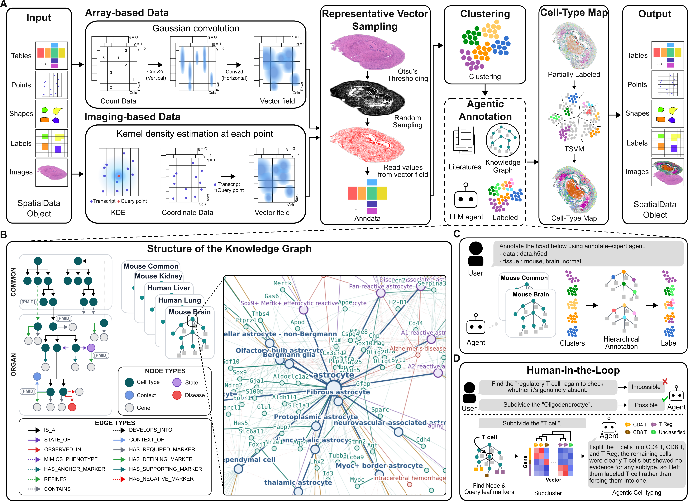

# CeLLMan

**AI agentic workflow for an automatic cell-type annotation based on knowledge graph of genes**

Assigning cell types from spatial transcriptomics usually depends on cell segmentation, which is
difficult to achieve accurately. CeLLMan removes that dependency: one specialized agent per organism
and organ mines PubMed into a knowledge graph of cell-type marker genes and infers cell identity from
mRNA signals alone — no segmentation, no neighborhood aggregation.

<p align="center">
  
</p>

---

## Installation

```bash
git clone https://github.com/pnucolab/CeLLMan.git
uv venv .venv --python 3.11
source .venv/bin/activate
```

```bash
uv pip install ./CeLLMan

# The default build enables AVX-512 on any x86_64 host without checking whether the CPU supports it,
# so a machine that lacks it aborts with an illegal instruction the first time the extension runs.
# Install with the line below instead if either applies:
#   - x86_64 Linux with no AVX-512 — `lscpu | grep -o avx512f | head -1` prints nothing
#                                    (most consumer Ryzen and Core chips)
#   - an Intel Mac                 — no Mac has ever shipped with AVX-512
# Apple Silicon and other ARM hosts need nothing extra: SIMD is not enabled there to begin with.

# uv pip install ./CeLLMan --config-settings=setup-args=-Dsimd=disabled
```

For GPU acceleration

```bash
uv pip install './CeLLMan[gpu]'
```

Then register the skill and the expert agent with your LLM host.

```bash
# claude code
mkdir -p .claude/skills .claude/agents
cp -r CeLLMan/Agentic-Annotation/skills/annotate-mode .claude/skills/
cp CeLLMan/Agentic-Annotation/agents/annotate-expert.md .claude/agents/
```

```bash
# codex
mkdir -p .agents/skills .codex/agents
cp -r CeLLMan/Agentic-Annotation/skills/annotate-mode .agents/skills/
cp CeLLMan/Agentic-Annotation/agents/annotate-expert.toml .codex/agents/
printf '\n[sandbox_workspace_write]\nnetwork_access = true\n' >> .codex/config.toml
```

---

## Documentation

Full documentation is in preparation and will be published on Read the Docs.

Until then, `notebooks/` holds one worked example per data modality:

| notebook | modality |
|---|---|
| [`notebooks/TS_lung.ipynb`](notebooks/TS_lung.ipynb) | scRNA-seq |
| [`notebooks/visiumhd_small_intestine.ipynb`](notebooks/visiumhd_small_intestine.ipynb) | array-based spatial transcriptomics |
| [`notebooks/xenium_kidney.ipynb`](notebooks/xenium_kidney.ipynb) | imaging-based spatial transcriptomics |

For how to phrase the prompt that starts an annotation run, see
[`Agentic-Annotation/CALLER_PROMPT_GUIDE.md`](Agentic-Annotation/CALLER_PROMPT_GUIDE.md).

---

## License

BSD 3-Clause. See [LICENSE](LICENSE).
